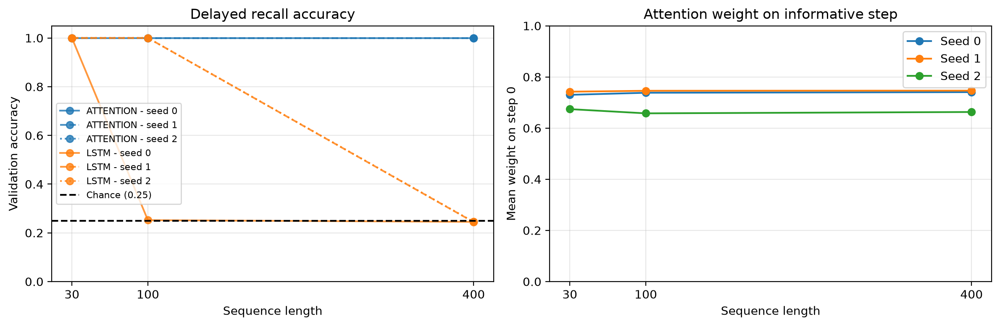

# AIGC-5500 Lab 5 - Attention Against Recurrence

**Student:** Daniel Alejandro Castillo Martin  
**Student ID:** N10019284  
**Course:** Advanced Deep Learning (AIGC-5500-0NA)  
**Professor:** Hossein Pourmodheji

---

Submission for Lab 05 of the Advanced Deep Learning course in the Artificial Intelligence with Machine Learning postgraduate program at Humber Polytechnic.

This project implements attention from scratch and compares it with recurrence, testing positional encodings, normalization, and computational cost.

## Setup

Python version: 3.14.6.  
PyTorch version: 2.14.1+cpu.

```powershell
python -m venv env
.\env\Scripts\Activate.ps1
python -m pip install -r requirements.txt
```

On macOS/Linux, activate with:

```bash
source env/bin/activate
```

## Run

Open `daniel_alejandro_castillo_martin_LAB5.ipynb`, select the Python environment, and run the cells from top to bottom from the repository root.

The professor's starter is preserved unchanged in `scripts/lab05_starter.py`.

To verify the starter separately:

```powershell
python scripts/lab05_starter.py
```

Figures and result tables are saved under `output/`. Running the notebook regenerates these files. Training results may vary across software versions and hardware; timings vary between executions.

## Tasks

**Delayed recall:** The first sequence step contains a class label, and subsequent steps contain noise. The model must recover the label. There are four classes, so chance accuracy is 0.25.

**Order classification:** Each sequence contains markers 1 and 2 once, plus filler tokens. The label indicates which marker appears first. Chance accuracy is 0.50.

## Starter Verification

The unchanged starter achieved 1.000 validation accuracy on both its attention recall check and order-classification check, and printed `Starter OK.`

## Experiments

1. Implement scaled dot-product and multi-head attention and verify against PyTorch.
2. Compare attention and an LSTM on delayed recall.
3. Evaluate positional encodings with fixed-length and mixed-length training.
4. Compare normalization layouts and measure forward and backward cost.

## Attention Verification

The custom attention function applies scaling by the square root of the key dimension, masks scores before softmax, and normalizes across keys. Assertions verify that weight rows sum to one and masked positions have exactly zero weight.

All checks passed for seeds 0, 1, and 2:

| Check | Cases | Largest absolute error |
|---|---:|---:|
| Attention function: unmasked and causal | 6 | 3.58e-07 |
| Multi-head: self, causal self, and cross-attention | 9 | 1.19e-07 |
| Permutation equivariance | 3 | 1.19e-07 |

Multi-head verification copied the projection weights and biases into PyTorch's module. Cross-attention used query length 5 and context length 7.

### Parameter Counts

| Model width | Heads | Features per head | Parameters |
|---:|---:|---:|---:|
| 32 | 1 | 32 | 4,224 |
| 32 | 2 | 16 | 4,224 |
| 32 | 4 | 8 | 4,224 |
| 32 | 8 | 4 | 4,224 |

At fixed width, heads partition the projected features without changing the four projection layers, so the parameter count remains unchanged.

Without positions or a mask, shuffling the input shuffled the output in the same way, confirming permutation equivariance for the tested inputs.

Detailed checks are saved in `output/attention_function_checks.csv`, `output/multihead_attention_checks.csv`, and `output/attention_permutation_checks.csv`.

## Delayed Recall Results

Both models use 600 updates, batch size 64, Adam with learning rate 0.003, and gradient clipping at 1.0. The LSTM uses hidden size 32 and effective forget bias 3. The attention readout uses width 32 and the custom attention function.

Matching lengths and seeds use identical training batches and validation sets.

| Model | Length | Seed 0 | Seed 1 | Seed 2 |
|---|---:|---:|---:|---:|
| Attention | 30 | 1.000 | 1.000 | 1.000 |
| LSTM | 30 | 1.000 | 1.000 | 1.000 |
| Attention | 100 | 1.000 | 1.000 | 1.000 |
| LSTM | 100 | 0.252 | 1.000 | 1.000 |
| Attention | 400 | 1.000 | 1.000 | 1.000 |
| LSTM | 400 | 0.245 | 0.244 | 0.245 |

### Attention Weight on Step 0

| Length | Seed 0 | Seed 1 | Seed 2 |
|---|---:|---:|---:|
| 30 | 0.7301 | 0.7424 | 0.6742 |
| 100 | 0.7382 | 0.7459 | 0.6577 |
| 400 | 0.7406 | 0.7465 | 0.6629 |



Attention exceeded chance (0.25) by 0.750 in every run and concentrated its weights on the informative step. The LSTM solved length 30, showed seed sensitivity at length 100, and remained near chance at length 400.

Attention directly accesses the informative input, while the LSTM must preserve it through successive recurrent updates. These results do not prove that LSTMs cannot learn longer dependencies or that vanishing gradients caused the failures; gradients were not measured in this experiment.

## Positional Encodings

Fixed-length training uses length 16, two pre-norm blocks, width 32, four heads, 800 updates, batch size 64, Adam with learning rate 0.002, and gradient clipping at 1.0.

### Fixed-Length Results

| Positions | Test length | Seed 0 | Seed 1 | Seed 2 |
|---|---:|---:|---:|---:|
| None | 16 | 0.552 | 0.523 | 0.447 |
| None | 32 | 0.503 | 0.484 | 0.498 |
| Learned | 16 | 1.000 | 1.000 | 1.000 |
| Learned | 32 | 0.626 | 0.606 | 0.622 |
| Sinusoidal | 16 | 1.000 | 1.000 | 1.000 |
| Sinusoidal | 32 | 0.624 | 0.665 | 0.748 |

Without positions, accuracy remained around chance (0.50). Self-attention followed by mean pooling cannot reliably distinguish marker order without position information.

Both positional encodings solved the training length, but neither generalized perfectly to length 32.

## Prediction (written before running the mixed-length training)

Training on lengths 8, 16, and 24 is expected to improve length-32 accuracy
for both learned and sinusoidal positions compared with training only at
length 16.

Learned positions will receive training for rows 0–23, leaving fewer
untrained positions at length 32. However, rows 24–31 remain untrained,
so generalization is expected to remain limited.

Sinusoidal positions may benefit from exposure to different lengths,
encouraging a more transferable ordering rule. Their fixed structure does
not guarantee extrapolation. Both encodings may perform worse at length 48.

## Mixed-Length Results

Each update draws a training length from 8, 16, and 24. Other training settings remain unchanged.

| Positions | Test length | Seed 0 | Seed 1 | Seed 2 |
|---|---:|---:|---:|---:|
| Learned | 16 | 0.994 | 1.000 | 1.000 |
| Learned | 32 | 0.716 | 0.715 | 0.718 |
| Learned | 48 | 0.548 | 0.547 | 0.532 |
| Sinusoidal | 16 | 1.000 | 1.000 | 1.000 |
| Sinusoidal | 32 | 0.894 | 0.912 | 0.930 |
| Sinusoidal | 48 | 0.622 | 0.587 | 0.762 |

The prediction was supported: length-32 accuracy improved for both encodings in every seed. Sinusoidal positions showed the larger improvement.

At length 48, learned positions approached chance (0.50), while sinusoidal results remained above chance but varied substantially. Mixed-length training did not guarantee reliable extrapolation.

Mixed-length training changes position coverage, generated examples, and the number of tokens processed under the same update budget. The results do not isolate one of these factors as the sole cause.

## Normalization Results

Twelve-block stacks use sinusoidal positions, length 16, 400 updates, learning rate 0.003, batch size 64, Adam, and gradient clipping at 1.0.

| Configuration | Seed 0 | Seed 1 | Seed 2 |
|---|---:|---:|---:|
| Post-norm, no warmup | 0.552 | 0.552 | 0.448 |
| Post-norm, 100-update warmup | 1.000 | 1.000 | 1.000 |
| Pre-norm, no warmup | 1.000 | 1.000 | 1.000 |

Post-norm without warmup remained around chance (0.50). Warmup enabled successful learning for post-norm, while pre-norm learned without warmup.

This comparison concerns one task, depth, learning rate, and training budget. Final accuracy alone does not identify the precise optimization failure or establish that post-norm always requires warmup.

## Timing

One LSTM layer and one custom attention layer were measured on CPU using batch size 32 and width 32. Each received one untimed warmup and three timed repeats per seed; the best repeat is reported.

Timing includes forward computation, a squared-output loss, and backward computation. It excludes model creation, input generation, gradient clearing, and optimizer updates.

Environment: PyTorch 2.14.1+cpu, 12 CPU threads.

| Model | Length | Seed 0 (ms) | Seed 1 (ms) | Seed 2 (ms) |
|---|---:|---:|---:|---:|
| LSTM | 100 | 12.5931 | 10.3230 | 4.5765 |
| Attention | 100 | 13.4272 | 5.2181 | 6.4120 |
| LSTM | 200 | 23.5964 | 16.8727 | 18.1690 |
| Attention | 200 | 30.3560 | 21.8633 | 26.7582 |
| LSTM | 400 | 47.2992 | 52.4827 | 63.6823 |
| Attention | 400 | 84.1546 | 136.8658 | 82.1485 |
| LSTM | 800 | 89.2451 | 63.9739 | 158.4891 |
| Attention | 800 | 468.9465 | 533.3013 | 558.0375 |

At length 100, timings overlapped. Attention was slower for every matching seed at lengths 200, 400, and 800.

The increasing cost is consistent with attention's quadratic pairwise matrices, but these noisy measurements do not establish an exact scaling law. The custom attention includes assertions and has 4,224 parameters; the optimized PyTorch LSTM has 8,448 parameters. Matching width does not match parameter count or implementation efficiency.

## Conclusion

Attention removed the need to carry recall information through successive recurrent updates and solved every tested recall length. Position information enabled order learning, and mixed-length training improved length-32 generalization without guaranteeing extrapolation.

Warmup enabled the tested post-norm stack to learn, while pre-norm succeeded without warmup. Direct access across positions comes with quadratic attention matrices, and the custom attention layer was slower at longer tested lengths on this CPU.